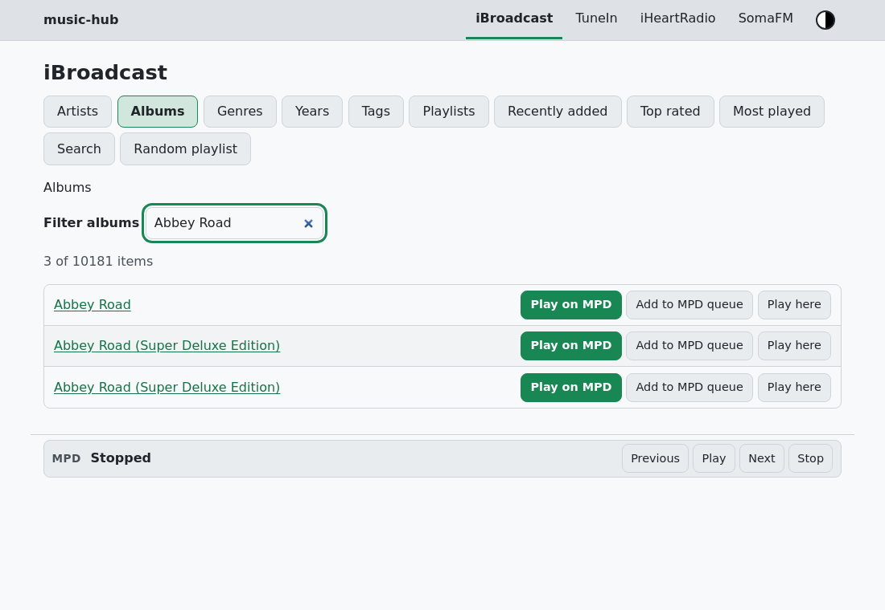
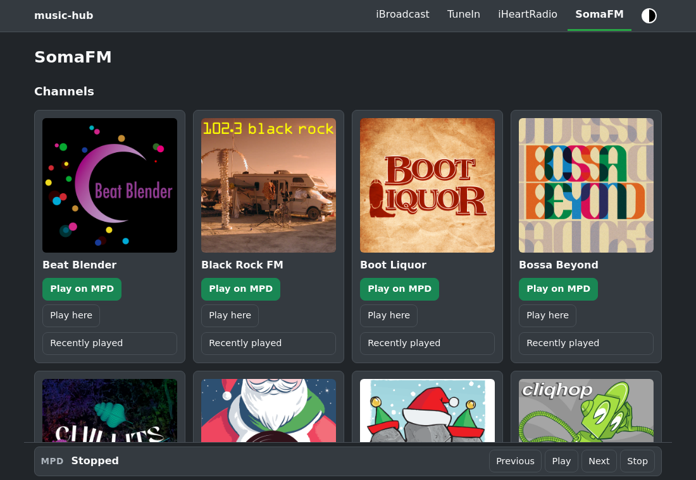
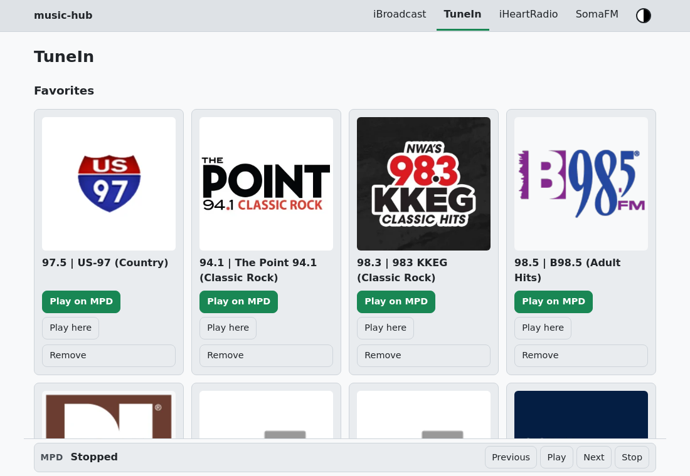
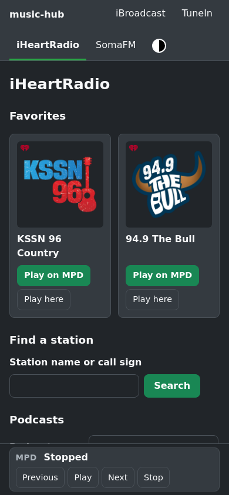

# music-hub

A web page for the music services that the mympd-* bridges serve: browse
your iBroadcast library and play TuneIn, iHeartRadio and SomaFM stations
from any browser, outside myMPD.

myMPD stays the main way in. music-hub is a second one, with its own
settings, and it uses the same bridges myMPD does, so both share one login
per service. Without MPD/myMPD, it can run its own copies of the bridges
and play everything in the browser instead.

<table>
<tr>
<td><a href="docs/images/screenshots/ibroadcast-albums.png"></a></td>
<td><a href="docs/images/screenshots/somafm-dark.png"></a></td>
</tr>
<tr>
<td><a href="docs/images/screenshots/tunein-favorites.png"></a></td>
<td><a href="docs/images/screenshots/iheart-phone-dark.png"></a></td>
</tr>
</table>

More in the [screenshot gallery](docs/images/screenshots/README.md).

## What it does

- **iBroadcast:** browse by artist, album, genre, year, tag or playlist;
  recently added, top rated and most played; search; and random playlists
  saved to MPD, iBroadcast or both.
- **TuneIn:** play favorites, search for stations and save or remove
  favorites.
- **iHeartRadio:** play favorites and searched stations, save favorites,
  and play podcast episodes.
- **SomaFM:** every channel, with its recently played songs.
- **Playback:** "Play on MPD" queues music the way myMPD does, so myMPD,
  scrobbling and listening history see it the same. "Play here" plays on
  the device viewing the page, with lock-screen and media-key controls on
  phones. Either mode can be turned off.
- Light, dark and automatic colors, the same look and round theme button as
  music-librarian.

## Requirements

- Docker with Compose, or Python 3.10 or newer (standard library only).
- The mympd-* bridges for the services you want:
  [mympd-ibroadcast](https://github.com/bonelifer/mympd-ibroadcast),
  [mympd-tunein](https://github.com/bonelifer/mympd-tunein),
  [mympd-iheart](https://github.com/bonelifer/mympd-iheart) and
  [mympd-somafm](https://github.com/bonelifer/mympd-somafm).
- MPD, for "Play on MPD".

## Setup beside myMPD

This uses the bridges myMPD already runs, so there is nothing to sign in to.

```bash
git clone https://github.com/bonelifer/music-hub.git
```

```bash
cd music-hub
```

```bash
cp music-hub.cfg.example music-hub.cfg
```

```bash
mkdir state
```

```bash
docker compose up -d
```

Open <http://127.0.0.1:18773/>. To use it from a phone or another computer,
set `[server] listen` to this computer's LAN address and add any host name
you open it by to `allowed_hosts`.

Without Docker, run `python3 music_hub.py serve`. `python3 music_hub.py
check-config` reports any setting with a bad value.

### myMPD Home tile

`install-mympd-tile.py` adds a tile to myMPD's Home screen that opens
music-hub in a new tab:

```bash
./install-mympd-tile.py --mympd http://127.0.0.1:8081 --url http://192.168.1.80:18773/
```

`--url` is the address the browser showing myMPD uses to reach music-hub,
so use the LAN address if you open myMPD on a phone. The tile uses myMPD's
built-in `hub` icon in white on myMPD's green, so no image is copied into
myMPD. Running it again updates the same tile instead of adding a second
one. Set `MYMPD_SESSION` when myMPD is protected by a PIN.

## Standalone setup (no MPD/myMPD)

`compose.standalone.yaml` starts music-hub with its own copies of the
bridges. They hold their own logins in `standalone/` and listen on 1877x
ports, so they never clash with a myMPD setup on the same computer. Music
plays in the browser only.

1. In `music-hub.cfg`, set `mpd_enabled = false` and point each
   `bridge_url` at the standalone ports listed at the top of
   `compose.standalone.yaml`. Set `enabled = false` for any service you have
   no login for.
2. Create the login files:
   - iBroadcast: put `IBROADCAST_CLIENT_ID=<your app ID>` in `.env`, create
     `standalone/ibroadcast`, then authorize once:

     ```bash
     docker compose -f compose.standalone.yaml run --rm ibroadcast authorize --token-file /state/token.json --write-playlists
     ```

   - TuneIn: `standalone/tunein.cfg`, in the format of mympd-tunein's
     `tunein.cfg.example`.
   - iHeartRadio: `standalone/test-account.json`, made by mympd-iheart's
     `test-account.py`.
   - SomaFM needs no login.
3. Start it:

   ```bash
   docker compose -f compose.standalone.yaml up -d
   ```

## Settings

Everything lives in `music-hub.cfg`; `music-hub.cfg.example` explains each
setting. These are music-hub's own preferences. Changing them never changes
myMPD's, and the reverse is also true.

| Setting | What it does |
|---------|--------------|
| `[playback] mpd_enabled` | Show "Play on MPD" and "Add to MPD queue" buttons |
| `[playback] browser_enabled` | Show "Play here" buttons |
| `[<service>] enabled` | Show that service |
| `[<service>] bridge_url` | The bridge that holds that service's login |
| `[ibroadcast] random_playlist_size` | Default song count for random playlists |
| `[ibroadcast] playlist_destination` | Default place to save them: `mpd`, `ibroadcast` or `both` |

## Security

music-hub has no login of its own, so anyone who can open the page can use
it. It listens on 127.0.0.1 by default; open it to your LAN only on a
network you trust. It refuses requests sent under an unlisted host name and
POST requests from other sites. The bridges stay on 127.0.0.1, and music-hub
passes iBroadcast audio through to the browser itself.

## Development

```bash
python3 -m unittest discover -s tests
```

The tests run offline against a fake bridge and a fake MPD. `tools/` holds
the checks used on a real setup:

- `tools/test-mpd.sh start|stop` runs a throwaway MPD on port 16601 with no
  sound output, so playing and saving never touch your real MPD.
- `tools/page_check.py URL AXE_JS [--play]` runs axe-core on every view in
  each theme at desktop and phone width, checks the theme button by
  keyboard, and with `--play` confirms a SomaFM channel plays in the
  browser.
- `tools/screenshots.py URL` retakes the screenshots in this README.

## TODO

Ideas not yet built, practical and speculative alike: [`docs/TODO.md`](docs/TODO.md).

## Contributing

Contributions are welcome!

- **Bug reports**: [Open an issue](https://github.com/bonelifer/music-hub/issues).
- **Everything else** (questions, feature requests, ideas, general discussion): [Use Discussions](https://github.com/bonelifer/music-hub/discussions).
- Pull requests are welcome for bug fixes or discussed features.

## Acknowledgments

- Code, tests and documentation written by [Claude](https://www.anthropic.com/claude).
- The colors and theme button come from music-librarian, which follows
  myMPD's look.

## License

This project is licensed under the **GNU General Public License v3.0**.

See [LICENSE](LICENSE) for more information.
