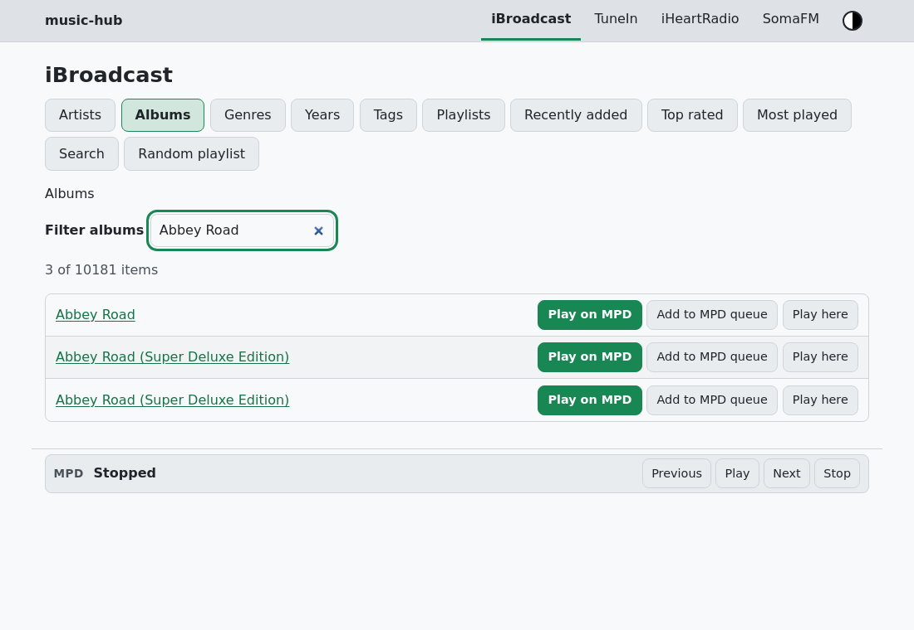
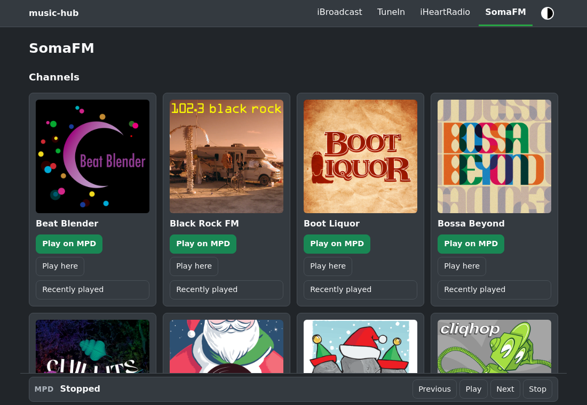
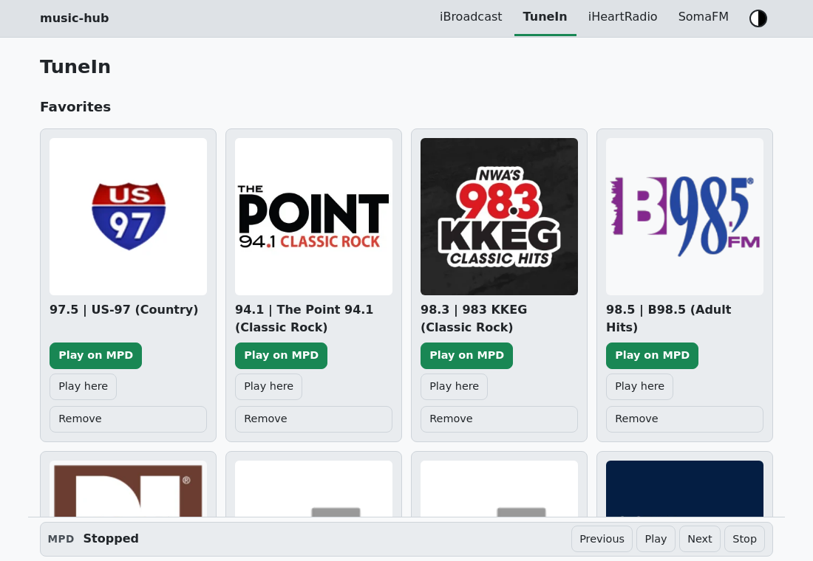
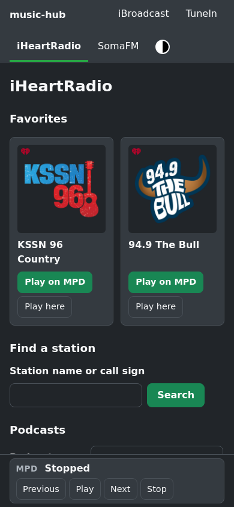

# Screenshots

Taken with `tools/screenshots.py` against a live setup.

## iBroadcast albums

Albums filtered to "Abbey Road". Each row can play on MPD, be added to the
MPD queue, or play in this browser.

## SomaFM, dark theme

Every channel as a card with its logo. "Recently played" shows the
channel's last few songs.

## TuneIn favorites

Favorites with Remove buttons. Search finds stations to save; TuneIn plays
stations once they are saved as favorites.

## iHeartRadio at phone width, dark theme

The same page on a phone: favorites, station search and podcasts.

